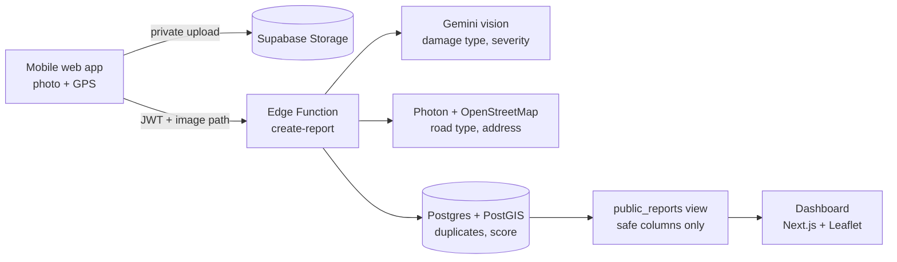

# FlowFix

FlowFix turns scattered citizen reports of road damage into a ranked, explainable maintenance list.

A citizen photographs damage on their phone. An AI vision model classifies it, geocoding adds the road it sits on, a duplicate check links nearby reports, and a deterministic score ranks it. The result appears on a public map dashboard that a municipality can read at a glance.

Built for Unihack 8, targeting the Glue It Together and Living Labs challenges.

**Live links**

- Mobile web app (for testers): [[web app URL](https://flow-fix-five.vercel.app/)]
- Municipal dashboard: [\[dashboard URL\]](https://flowfix-dashboard.vercel.app/)

## How it works



One report goes through this pipeline:

1. The app captures a photo and the best available GPS fix, and shows the location accuracy to the user.
2. The photo uploads to a private Storage bucket under the user's anonymous session folder.
3. The `create-report` Edge Function verifies the caller, validates the image and request, and applies a per-user hourly limit.
4. Vision classification and reverse geocoding run in parallel.
5. A PostGIS lookup finds a nearby report of the same damage type. If one exists, the new report is linked as a duplicate and corroborates the original, which is then re-scored.
6. The deterministic score is computed and stored. The public dashboard reads only the safe view.

## The score

The score is plain arithmetic, not a model output, so every number can be explained.

```
priority = round((65 * severity + 15 * road + 20 * corroboration) / 100)

severity      = (AI severity 1..5 - 1) * 25
road          = road-importance weight for the road type (0..100; unknown = 40)
corroboration = min(distinct corroborating reporters, 5) * 20
```

| Band   | Score     |
| ------ | --------- |
| low    | 0 to 34   |
| medium | 35 to 54  |
| high   | 55 to 74  |
| urgent | 75 to 100 |

Worked example: severity 4 on a residential road with no corroboration scores 56 (high). One corroborating reporter raises it to 60.

AI confidence is not a score input. Below the configured threshold (default 0.60) it only flags the report for human review. The full road-weight table is in [docs/PROJECT_STRUCTURE.md](docs/PROJECT_STRUCTURE.md).

## Glue It Together: what is integrated

| Component                        | Role                                                 |
| -------------------------------- | ---------------------------------------------------- |
| Expo / React Native (web export) | Capture, location, result screen                     |
| Supabase Auth                    | Anonymous sessions, no sign-up friction              |
| Supabase Storage                 | Private photo bucket with per-user folders           |
| Supabase Edge Functions          | Orchestration and all secrets                        |
| Gemini vision API                | Damage type, severity, confidence                    |
| Photon and OpenStreetMap         | Road type and address from coordinates               |
| Postgres and PostGIS             | Duplicate detection, corroboration, safe public view |
| Next.js and Leaflet              | Municipal dashboard with score breakdown             |

## Living Labs: evidence

All evidence lives in [docs/evidence](docs/evidence) and contains only real observations from real sessions. Anything not measured is marked "Not measured".

- [interviews.md](docs/evidence/interviews.md): problem interviews
- [feedback.md](docs/evidence/feedback.md): prototype test notes
- [iterations.md](docs/evidence/iterations.md): what changed and why
- [metrics.md](docs/evidence/metrics.md): measurements with sample sizes

Status at submission: 10 interviews and 5 test sessions logged. The sample is small, so treat the numbers as early signals.

## Security and privacy

- Row Level Security is enabled on every table. Clients can read only their own reports and cannot insert, update or delete directly.
- The public dashboard reads a view that excludes reporter IDs, image paths, errors and confidence values. Duplicate and failed rows never appear on the map.
- The photo bucket is private, with a size limit, an image-type allow-list, and a per-user folder policy.
- Both RPC functions are executable only by the service role.
- The service-role key and the vision key live only in Edge Function secrets, never in client code.
- Reporting is anonymous. Photos are sent to Google's Gemini API for classification, so do not photograph faces or license plates.

## Run it locally (Windows PowerShell)

Requirements: Node.js, Deno, the Supabase CLI, Docker Desktop for the local stack.

```powershell
# Mobile web app
Set-Location mobile
npm.cmd install
$env:EXPO_PUBLIC_SUPABASE_URL = "https://<project-ref>.supabase.co"
$env:EXPO_PUBLIC_SUPABASE_ANON_KEY = "<anon-key>"
npx.cmd expo start --web

# Dashboard
Set-Location ..\dashboard
npm.cmd install
$env:NEXT_PUBLIC_SUPABASE_URL = "https://<project-ref>.supabase.co"
$env:NEXT_PUBLIC_SUPABASE_ANON_KEY = "<anon-key>"
npm.cmd run dev
```

Use only the anon key in client apps.

**Backend**

```powershell
supabase.cmd login
supabase.cmd link --project-ref <project-ref>
supabase.cmd db push
supabase.cmd functions deploy create-report
```

Set the Edge Function secrets in your own terminal. The full list of names is in [supabase/functions/.env.example](supabase/functions/.env.example). It is documentation only and never a source of values. Key settings include `VISION_API_KEY`, `VISION_PROVIDER`, `VISION_MODEL`, `ALLOWED_ORIGINS`, `APP_CONTACT`, `MAX_REPORTS_PER_HOUR` and `ENABLE_CORROBORATION`.

Optional demo data: run [supabase/seed_demo.sql](supabase/seed_demo.sql) in the SQL editor. Seeded rows are labelled "Demo data" in the UI.

## Checks

```powershell
deno.cmd test --allow-env supabase/functions   # scoring, vision, geocoding, create-report
.\scripts\check.ps1                            # offline checks and web export
.\scripts\rls-smoke.ps1                        # live access checks (needs SUPABASE_URL and SUPABASE_ANON_KEY)
.\scripts\two-session-check.ps1 -ImagePath <photo.jpg>   # cross-user isolation (creates one real report)
```

## Repository layout

```
mobile/        Expo app and web export
dashboard/     Next.js dashboard
supabase/      migrations, seed data, Edge Functions (create-report, _shared)
scripts/       checks and smoke tests
docs/          project structure, task list, validation plan, evidence
```

## Known limitations

- Severity is an AI estimate, not an engineering assessment. The app says so on every result.
- Road context depends on a free community geocoder (Photon) with no uptime guarantee. If it fails, the report is still created with the road type set to unknown and a neutral road weight.
- Location accuracy depends on the device. The app shows the accuracy and asks the user to retry when it is poor.
- Anonymous identities reset when browser storage is cleared, so corroboration is a rough signal, not proof of independent verification.
- Duplicate detection uses a fixed radius and the AI's damage type, so unusual cases can be missed or merged wrongly.
- User testing so far is small. See [docs/evidence](docs/evidence) for what was actually measured.

## Documentation

- [docs/PROJECT_STRUCTURE.md](docs/PROJECT_STRUCTURE.md): architecture, data model, API contracts
- [docs/TODO.md](docs/TODO.md): task list and acceptance criteria
- [docs/VALIDATION.md](docs/VALIDATION.md): tests, failure modes, demo plan

## Credits

Map data and road context: OpenStreetMap contributors. Reverse geocoding by Photon (Komoot). Damage classification by Google Gemini.

Team: The Clover
